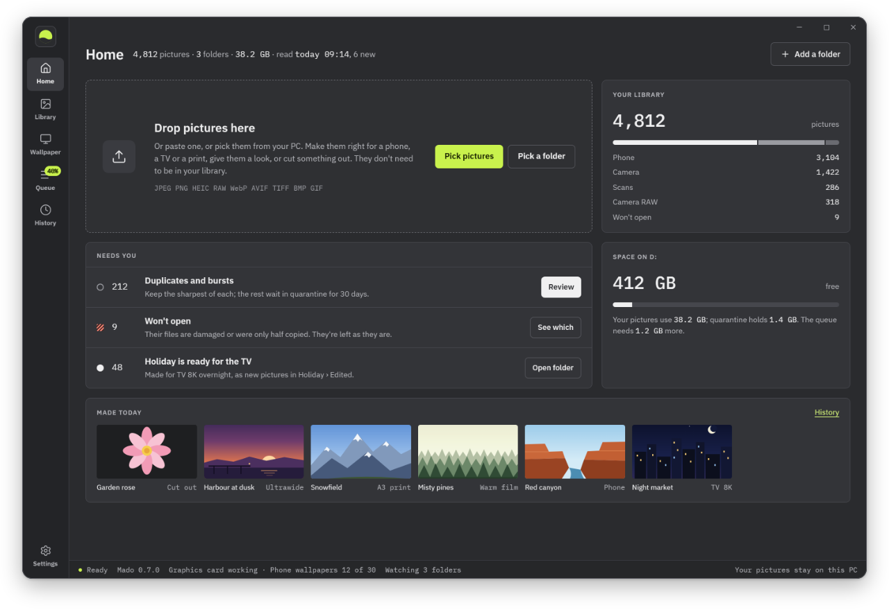
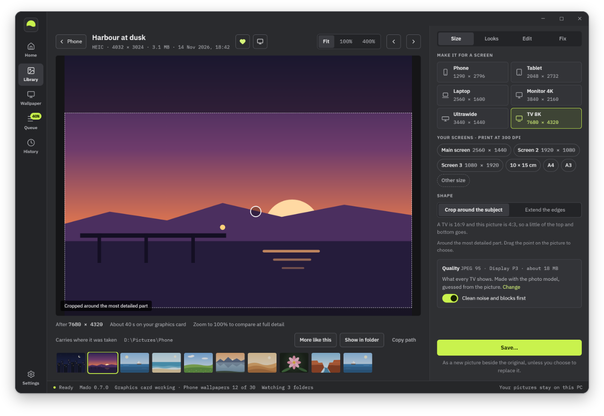
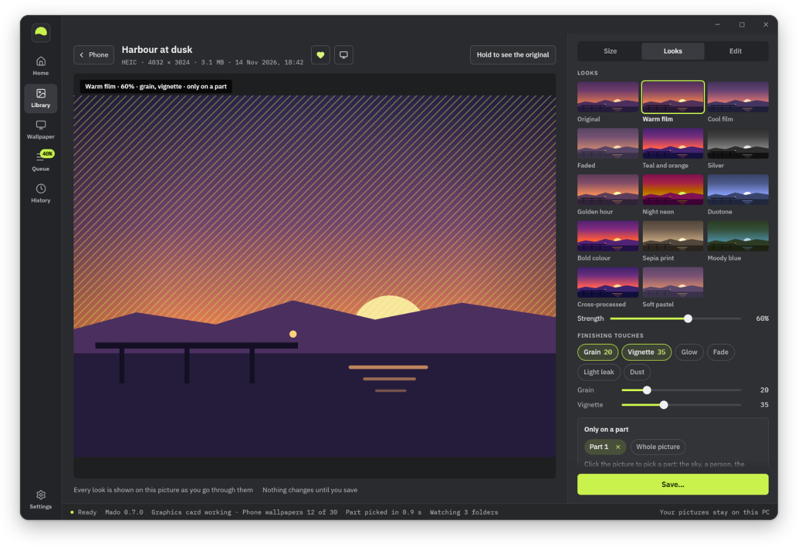
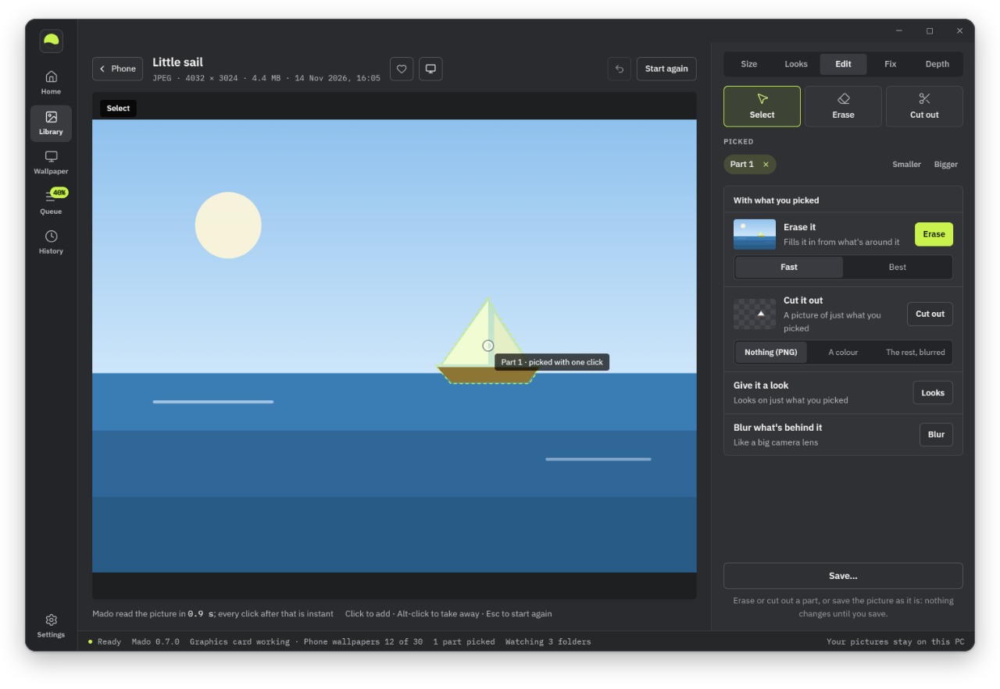
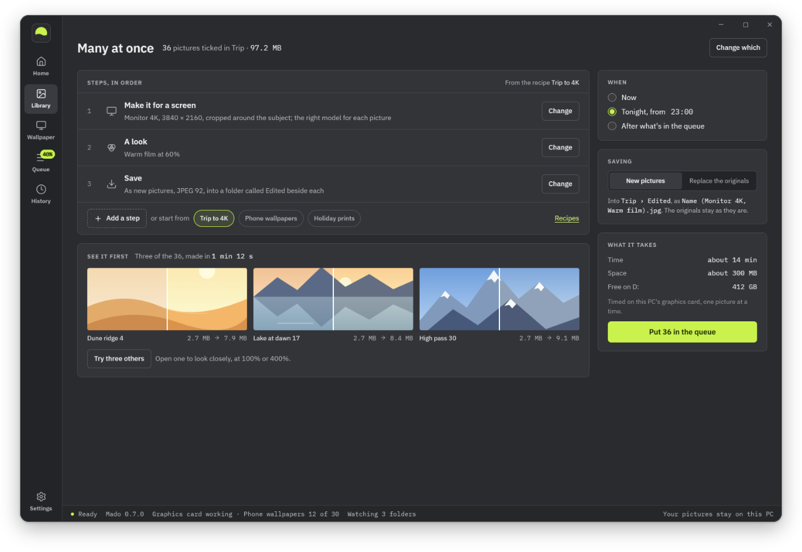
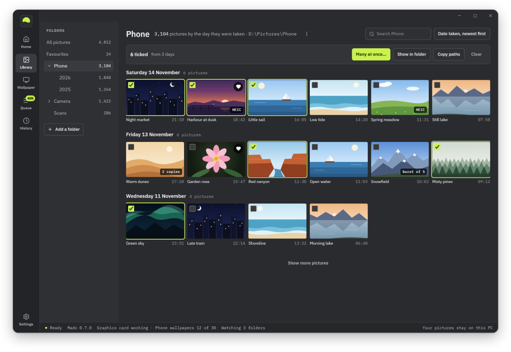
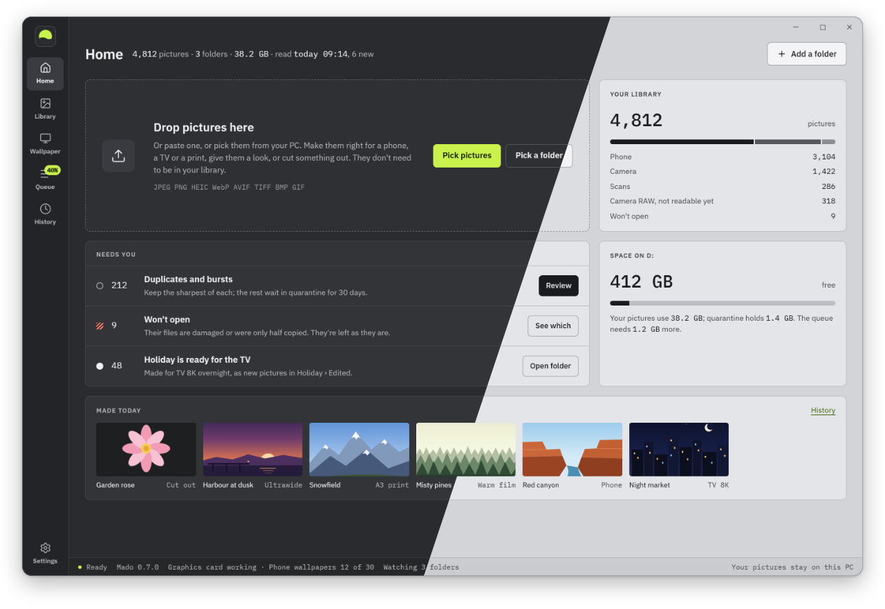
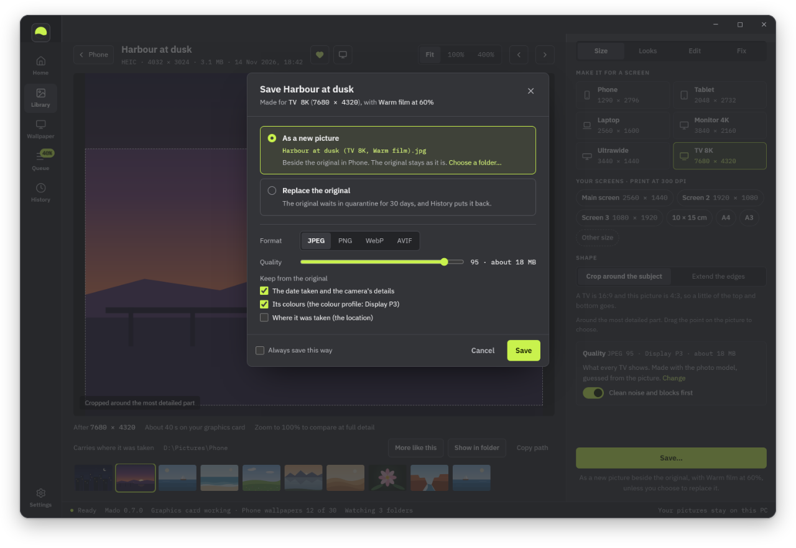

# Mado

**Your pictures, right for every screen.**

Mado (窓, "window") makes your pictures right for any screen, from a phone to an 8K TV, or for a
print. It gives them looks, edits them with a click, does it all to many at once, and keeps a
library of the folders they live in. Small AI models do the hard parts, on your own Windows PC.
Nothing is uploaded, and nothing changes until you say.

   
  
   
  Free and open source · No account · Windows 10 and 11
   
  <b>Early days.</b> Mado keeps your library and finds its duplicates and bursts, makes pictures right for any screen or print, gives them looks, erases or cuts out what you click, and does it all to many at once.
   
   

Mado's screens as designed. The app is being built to them.

## Made for every screen

Your pictures come from phones, cameras, scanners and screenshots, and you want them everywhere: a
phone's lock screen, an ultrawide monitor, the TV, a print on the wall. Each place wants its own
pixels, shape and quality. Stretch a picture and it goes soft. Crop it carelessly and it loses its
subject. Fix it online and it leaves your PC. Mado makes each picture right for where it's going,
on your own PC, and shows you before anything is saved.

## How it works

### 1. Right for every screen

Choose where a picture is going: a phone, a tablet, a laptop, a monitor, an ultrawide, a 4K or 8K
TV, or a print. Mado makes it exactly the pixels and shape it needs there, cropped around the
subject or with its edges extended, in the format and quality that suit it. It remembers your own
screens. It treats each picture as what it is: one AI model for photos, another for drawings, a
gentler way for screenshots so letters stay letters, and none at all for pixel art, which stays
crisp. It clears out noise first, or keeps a photo's grain if you'd rather. Drag the line to
compare before and after, as close as you like. And Mado is honest about limits: two to four
times bigger looks real, while 8K from a thumbnail looks painted.

### 2. Looks that make a picture

Go through the looks and each one shows on your picture as you pass it: film, cinematic, black and
white, golden hour, night neon, duotone and more. Set how strong it is, then add finishing touches:
grain, a vignette, glow, fade, light leaks or dust. Click the sky, a person or the background to
give just that part a look. Keep a mix you like as a look of your own, or bring in the .cube files
you already use.

### 3. Edit by clicking

Click anything to select it, such as a boat, a person or the sky, and Mado finds its edges. Click
again to add more. Then erase it, and Mado fills the space from what's around it. Or cut it out as
a picture of its own, with nothing, a colour or the rest blurred behind it. Or give just that part
a look.

### 4. Many at once

Tick pictures in the library, choose a folder, or drop a pile on the window, and put any tool to
work on all of them. Keep the steps as a recipe, such as "4K, then Warm film at 60%, then JPEG into
Edited", and use it on any batch, or on every new picture put in a watch folder. Mado shows it
first on a few, so you know it's right, and works out the time and space before it starts. Then the
queue does the rest, one picture at a time, now or overnight.

### 5. Your library

Add the folders your pictures live in. Mado reads pictures from phones, cameras and scanners, in
JPEG, HEIC, RAW and more, and keeps the HDR and wide colours of newer phones' photos. It shows them
by the day they were taken, watches the folders for new ones, and finds duplicates and bursts: you
keep the sharpest, and the rest wait in quarantine. A picture doesn't have to be in the library:
drop it on the window, paste it, or right-click it in File Explorer.

### 6. Light or dark

Mado's look is Graphite: the mid-grey that photo editors judge colour on, so the window never
changes how a picture's colours look. Its light is Aluminium. Mado turns light or dark with
Windows, or stays the way you choose in Settings. Your pictures look the same in both.

## Safe by design

<table>
  <tr>
    <td nowrap><b>Stays local</b></td>
    <td>Everything happens on your PC, AI included. Nothing is uploaded, and there's no account.</td>
  </tr>
  <tr>
    <td nowrap><b>Asks first</b></td>
    <td>Nothing changes until you say. A result is a new picture beside the original, unless you choose to replace it; renames, moves and deletions are proposed first.</td>
  </tr>
  <tr>
    <td nowrap><b>Keeps copies</b></td>
    <td>A replaced original, or a duplicate you let go, waits 30 days in quarantine, and History puts it back.</td>
  </tr>
  <tr>
    <td nowrap><b>Your own pictures</b></td>
    <td>Mado works on pictures already on your PC. It never searches for, downloads or shares pictures.</td>
  </tr>
  <tr>
    <td nowrap><b>Backs up</b></td>
    <td>Mado's records are backed up every night, and export as one zip. Uninstalling never touches your pictures.</td>
  </tr>
</table>

Mado contains no photos, artwork or other media. Every picture in these screens is drawn by code,
and every name in them is made up.

## The AI inside

Every AI model Mado uses is named here, with its licence. Each arrives with the tool that uses
it, and each runs on your PC.

| Model | What it does in Mado | Licence |
| --- | --- | --- |
| Real-ESRGAN general (`realesr-general-x4v3`), and its weak-denoise twin | Fast: makes photos and drawings four times bigger, cleaning noise and JPEG blocks, or keeping grain | BSD-3-Clause |
| RealESRGAN x4plus anime 6B | Best for drawings, comics and flat colour | BSD-3-Clause, Apache-2.0 |
| RealESRGAN x4plus | Best for photos (downloaded the first time it's asked for, 67 MB) | BSD-3-Clause, Apache-2.0 |
| LaMa | Draws more of a picture at its edges, to fit a screen's shape, and erases a part at Best (downloaded the first time, 209 MB) | Apache-2.0 |
| SAM 2.1 (tiny) | Picks a part of a picture with a click, to erase it, cut it out, blur what's behind it or give it a look (downloaded the first time, 156 MB) | Apache-2.0 |
| MI-GAN | Fast: erases a part, filling it from what's around it (downloaded the first time, 28 MB) | MIT |
| U²-Net, its small model (`u2netp`) | Fast: finds a picture's subject and cuts it out, no click needed (comes with Mado, 4.6 MB) | Apache-2.0, its ONNX conversion MIT |
| BiRefNet lite | Best: cuts out a picture's subject with the finest edges (downloaded the first time, 224 MB) | MIT |

They run on ONNX Runtime (MIT) with Microsoft's DirectML, which Mado carries under Microsoft's
terms.

- **Small, and on your PC.** Every model runs here, on the graphics card when there is one. No
  picture leaves your PC.
- **Free to share.** Each is on a licence that lets Mado share it, and is measured for quality and
  speed before it's chosen.
- **Fast and Best.** Where the graphics card matters, a tool comes in two sizes, so a smaller card
  still gets it.
- **No pictures from words.** The big models that make pictures from words don't fit an ordinary
  graphics card, and their licences aren't ones Mado allows. Mado works on the pictures you have.

## Download

Every version is on the [downloads page](https://frankgrobbelaar.github.io/mado/), newest first,
with what changed ([CHANGELOG.md](CHANGELOG.md)). Mado is in its early days, and each version
brings more of the tour above. Mado installs just for
you, without asking for an administrator, and updates itself. It isn't code-signed, so SmartScreen
warns the first time: More info › Run anyway. The installer's first page lists everything Mado
downloads, such as ffmpeg on the first run; nothing is installed by hand.

### What your PC needs

- **Windows 10 or 11**, 64-bit.
- **8 GB of memory.**
- **A graphics card** isn't needed, but one that supports DirectX 12 makes the AI tools quick:
  a phone's photo made for a 4K screen takes seconds with Fast, and Best, for the finest detail,
  wants a card with 4 GB of its own. Without one, they run on the processor, more slowly, and
  Mado starts on Fast.

Mado tests your PC when it's set up, times each AI model on it, and says what each does there in
Settings › About.

## Its siblings

Mado is built on the same foundations as [Kura](https://github.com/frankgrobbelaar/kura), for an
anime library, and [Maku](https://github.com/frankgrobbelaar/maku), for TV series and films, and
takes their care with your files: the queue and History join it with its tools. How Mado itself
is built is in [docs](docs/README.md).

## Licence

Free software under the [MIT licence](LICENSE), with no warranty; what it's built on is listed,
each part with its licence, in `THIRD-PARTY-NOTICES.txt` with every release. The repo takes no
contributions; forks are welcome.
