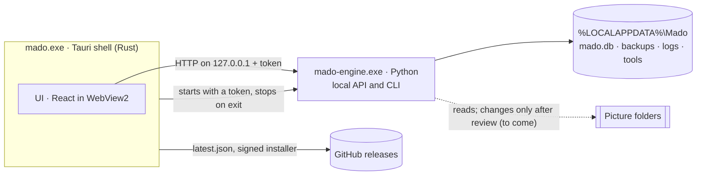

# Architecture

Mado is three programs that work as one: a thin **shell** that owns the window, a **UI** inside it,
and an **engine** that does the real work. Everything runs on this PC; the only network traffic is
fetching what the installer lists (ffmpeg) and checking for updates.

| Part | Where | Does |
| --- | --- | --- |
| Shell | `app/src-tauri` | The window and its title bar, one instance at a time, the engine's lifetime, updates, the tray |
| UI | `app/src` | Every screen. Reads and changes things only through the engine's API |
| Engine | `engine/src/mado` | Setup's downloads, settings, backups, the export, the database; the pictures' tools to come |

The shell stays small on purpose: logic that isn't about the window or the process belongs in the
engine, where it is easy to test.

## Start, run, stop

1. The shell starts `mado serve --watch-stdin` with a fresh random token in `MADO_TOKEN`
   (in development: `uv run mado …` from `engine/`; installed: the bundled `mado-engine.exe`).
2. The engine listens on `127.0.0.1` on a free port and prints one line:
   `{"event": "ready", "port": 51234}`.
3. The shell sends the UI an `engine-status` event with the address and token.
4. The UI calls the API with `Authorization: Bearer <token>`.
5. On exit the shell closes the engine's stdin and the engine shuts down (the shell ends it after
   3 seconds if it hasn't). If Mado crashes, Windows closes the pipe anyway, so the engine never
   outlives the window. The engine puts itself in a Windows job that ends every program it starts
   (ffmpeg) when it ends, however it ends.
6. With "Start with Windows" on (Settings › General), Windows starts Mado at sign-in in the tray.
   With "Keep Mado running when you close the window" on (beside it), closing the window keeps
   Mado there, so its work and the nightly backup carry on; Quit Mado in the tray's menu ends it.
   Off, closing the window quits Mado. After the ready line the engine may print
   `{"event": "notify", "title": …, "body": …, "link": …}` lines, which the shell shows as Windows
   notifications while the window is away, and passes to the window while it's open (the `notice`
   event), where they show as a note at its foot.

If the engine is silent for a minute before its ready line, exits first, or stops on its own later,
the status becomes `failed` with the engine's last error lines, and the UI says so with "Try again"
and "Copy details". While the window is away (Mado waiting in the tray), a Windows notification
says so once, and the shell tries again by itself after 30 seconds, a minute, 5 minutes, then every
15. Both sides of this handshake are tested: `engine/tests/test_cli.py` and
`app/src-tauri/src/engine.rs`.

## Contracts

| Between | How | Kept honest by |
| --- | --- | --- |
| Shell and engine | `serve` arguments, `MADO_TOKEN`, the ready line, stdin | Tests on both sides |
| Shell and UI | Commands `engine_status`, `restart_engine`, `prepare_update`, `install_update`; event `engine-status` | Types mirrored in `app/src/lib/engine.tsx` and `updates.ts` |
| UI and engine | JSON over HTTP, camelCase | `engine/openapi.json` snapshot + test; types in `app/src/lib/engine.tsx` |

Change a contract on both sides in the same commit.

## The engine's API

| Route | For |
| --- | --- |
| `GET /health` | Is the engine up, its version, the data folder, the schema version (0 while the records are damaged) |
| `GET /settings`, `PUT /settings` | The owner's choices; so far whether Setup is done |
| `GET /tools`, `POST /tools/{id}/download` | What Mado downloads (ffmpeg), its state, and fetching it |
| `GET /backups`, `POST /backups`, `POST /backups/import`, `POST /backups/{name}/restore` | The backups, one made by hand, importing an export, restoring one as the engine starts again |
| `GET /data`, `POST /export` | What the data folder holds, by part, and the export zip |
| `GET /records`, `POST /records/restore`, `POST /records/new` | Records damaged past use, and the two ways back |

## Data

- **The data folder**, `%LOCALAPPDATA%\Mado`: `mado.db` (everything Mado knows), `logs/`
  (`engine.log`, kept 30 days), `tools/` (ffmpeg), `cache/`, and `backups/` (the last 7 nights,
  each checked as it's made, and apart from them the last 7 made by hand, before a restore and
  from an export; none is ever written over). `mado/care.py` makes tonight's backup from 03:00 (or
  the first chance after). A backup chosen in Settings is restored as the engine starts again,
  before anything opens the database, once it checks out; what Mado knew till then is backed up
  first, and kept even when it doesn't check out. Development uses `engine/.dev-data`, so it never
  touches the real folder.
- **The database** is SQLite, upgraded in place by migrations (see [stack/sqlite.md](stack/sqlite.md)).
  A database written by a newer Mado is refused, not damaged. Records damaged past use (a disk
  fault, a power cut mid-write: `mado/rescue.py`) are found as the engine starts, before anything
  else opens them; the engine then answers only `/records` and `/health`, and the app's window
  shows the way back in place of every page: the newest backup that opens, restored over them, or,
  with none, new records as on Mado's first day (when the disk couldn't read them, Try again comes
  first). Either way the damaged file is set aside as it is, never deleted, and the app starts the
  engine again.
- **Export**: one zip, readable without Mado, written to a folder the owner picks in Settings (or
  with `mado export`). It grows with the schema. Settings imports one too: the database it holds
  is restored like a backup as the engine starts again, and what Mado knew till then is backed up
  first. An export from a newer Mado waits for an update.

## Safety on a shared PC

- The engine listens only on `127.0.0.1`, on a port chosen at random.
- Every request needs the launch's token; anything else gets 401.
- Only the app's own pages may call it (CORS), and only when addressed to this PC (Host check).
- The window's content security policy allows the app itself, Tauri's IPC and the local engine.
- The window may call only the core APIs, its title bar buttons and Mado's own commands
  (`app/src-tauri/capabilities/default.json`).
- An update runs only if its signature matches the public key built into Mado.

## On an installed PC

| What | Where |
| --- | --- |
| Program | `%LOCALAPPDATA%\Programs\Mado` (`mado.exe`, `engine\`, `uninstall.exe`) |
| Data | `%LOCALAPPDATA%\Mado` |
| WebView2 cache | `%LOCALAPPDATA%\io.github.frankgrobbelaar.mado` |
| Uninstaller's export | `Documents\Mado export <date>.zip` |
