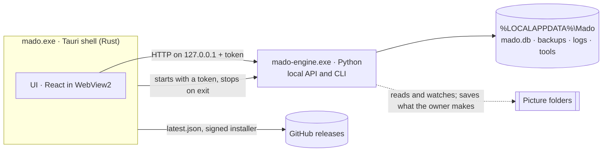
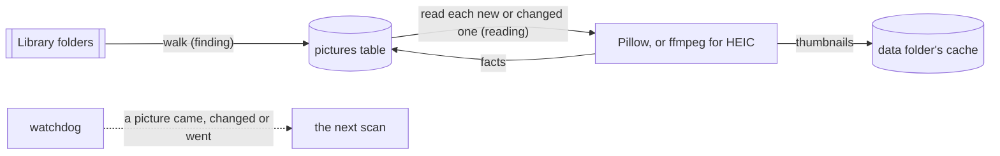
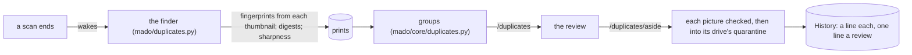
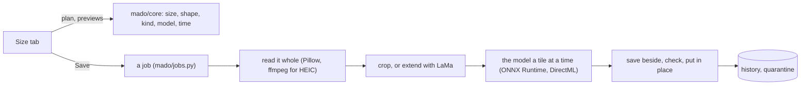
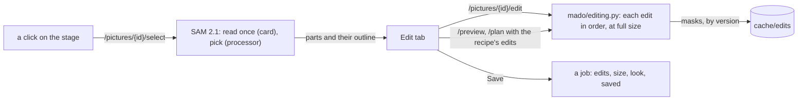
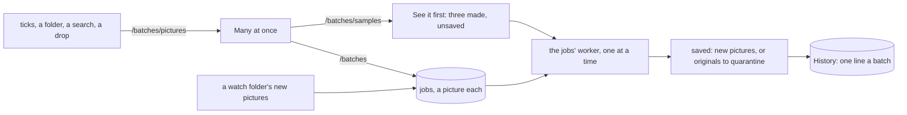
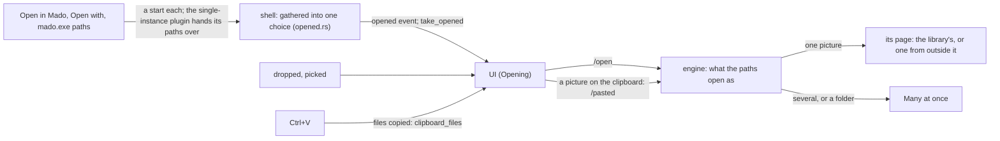

# Architecture

Mado is three programs that work as one: a thin **shell** that owns the window, a **UI** inside it,
and an **engine** that does the real work. Everything runs on this PC; the only network traffic is
fetching what the installer lists (ffmpeg, and the bigger AI models when first asked for) and
checking for updates.

| Part | Where | Does |
| --- | --- | --- |
| Shell | `app/src-tauri` | The window and its title bar, one instance at a time, the engine's lifetime, updates, the tray; the paths Windows hands Mado, the files copied in File Explorer, and File Explorer's "Open in Mado" |
| UI | `app/src` | Every screen. Reads and changes things only through the engine's API |
| Engine | `engine/src/mado` | The library (its folders, the scan, the watcher, the copies the window shows, duplicates and bursts), editing pictures by clicking, making them right for a screen (the AI models on the graphics card) and giving them a look, and saving them, many at once in the queue with recipes and watch folders, History and the quarantine, this PC's check, Setup's downloads, settings, backups, the export, the database |

The shell stays small on purpose: logic that isn't about the window or the process belongs in the
engine, where it is easy to test.

## Start, run, stop

1. The shell starts `mado serve --watch-stdin` with a fresh random token in `MADO_TOKEN`
   (in development: `uv run mado …` from `engine/`; installed: the bundled `mado-engine.exe`).
2. The engine listens on `127.0.0.1` on a free port and prints one line:
   `{"event": "ready", "port": 51234}`.
3. The shell sends the UI an `engine-status` event with the address and token.
4. The UI calls the API with `Authorization: Bearer <token>`.
5. On exit the shell closes the engine's stdin and the engine shuts down (the shell ends it after
   3 seconds if it hasn't). If Mado crashes, Windows closes the pipe anyway, so the engine never
   outlives the window. The engine puts itself in a Windows job that ends every program it starts
   (ffmpeg) when it ends, however it ends.
6. With "Start with Windows" on (Settings › General), Windows starts Mado at sign-in in the tray.
   With "Keep Mado running when you close the window" on (beside it), closing the window keeps
   Mado there, so its work and the nightly backup carry on; Quit Mado in the tray's menu ends it.
   Off, closing the window quits Mado. After the ready line the engine may print
   `{"event": "notify", "title": …, "body": …, "link": …}` lines, which the shell shows as Windows
   notifications while the window is away, and passes to the window while it's open (the `notice`
   event), where they show as a note at its foot.

If the engine is silent for a minute before its ready line, exits first, or stops on its own later,
the status becomes `failed` with the engine's last error lines, and the UI says so with "Try again"
and "Copy details". While the window is away (Mado waiting in the tray), a Windows notification
says so once, and the shell tries again by itself after 30 seconds, a minute, 5 minutes, then every
15. Both sides of this handshake are tested: `engine/tests/test_cli.py` and
`app/src-tauri/src/engine.rs`.

## The library

The owner adds folders; the engine reads every picture in them and keeps watching. Nothing in
the folders changes: the library only looks.

| Part | File | Does |
| --- | --- | --- |
| Folders | `mado/library.py` | Adding a folder (one inside a library folder is refused; one holding library folders takes them in), taking one out, and walking one to record every picture with its size, time and place |
| Reading | `mado/pictures.py` | A picture's facts (format, size as shown, when it was taken, camera, orientation, a location) from its header and EXIF, and its pixels, turned upright (see [stack/pillow.md](stack/pillow.md)) |
| The scan | `mado/scan.py` | One at a time, on its own thread: finding (walking every folder: new, changed and gone pictures), then reading what's new or changed, newest file first, making each thumbnail on the way. Everything is saved as it goes, so a scan Mado's closing stops loses nothing |
| The watcher | `mado/watch.py` | A scan as Mado starts, and one a few seconds after a picture comes, changes or goes (see [stack/watchdog.md](stack/watchdog.md)) |
| Copies | `mado/previews.py` | A thumbnail (512 px), a view the size of a screen (2560 px) and a full-size copy for a format the window can't show, made once and kept in the cache |
| Rules | `mado/core/` | What a file is by its name, how folders sit together, EXIF's values in Mado's words, a HEIF's layout: pure functions |

A picture's copies come to the window through the API like everything else, with the token: the
UI fetches each and shows it as an object URL (`usePictureImage` in `app/src/lib/engine.tsx`),
thumbnails only as they come near the view, so the grid holds many thousands.

## Looking after the library

Duplicates and bursts are found in the background, from the thumbnails the scan made, and
reviewed on a page of their own; Home's Needs you also lists the pictures that won't open, and
its Space card the room on the drives the library uses. docs/stack/duplicates.md has the
fingerprints, the thresholds and what was measured.

| Part | File | Does |
| --- | --- | --- |
| The rules | `mado/core/likeness.py`, `mado/core/duplicates.py` | Pure: fingerprints, sharpness, close fingerprints in buckets; the groups, what's never grouped, which to keep |
| The finder | `mado/duplicates.py` | Looking at each picture once it's read and again once it changes, on a thread of its own; the groups kept in memory; the owner's choices and "not the same"; setting the rest aside, each picture checked first |
| Won't open | `mado/api/library.py`, `mado/api/pictures.py` | The pictures that won't open, but those marked as damaged; marking one (`pictures.damaged`, cleared once its file changes) |
| Space | `mado/api/library.py` | Each drive the library's folders are on: free, the pictures, quarantine, what the queue wants there |
| In use | `mado/jobs.py` | A picture open in another app waits and is tried again by itself (docs/stack/queue.md) |

## Making a picture right for a screen

The Size tab asks the engine for a plan as the owner chooses (a size, the shape, the point to crop
around, what the picture is, Fast or Best), shows previews of the part being looked at, and on
Save starts a job. Nothing changes until then: the job writes a new picture beside the original,
or puts it in the original's place with the original set aside in quarantine, and History says
so. docs/stack/upscaling.md has the models, the tiles and DirectML's rules; docs/stack/hardware.md
the PC check.

| Part | File | Does |
| --- | --- | --- |
| The rules | `mado/core/` (`sizes`, `framing`, `kind`, `models`, `recipe`, `tiles`, `quality`, `estimate`, `hardware`, `naming`, `outpaint`) | Pure: the sizes, the shape and its words, what a picture is, the model it suits, the plan, the tiles, the format, the time, what this PC can do, names |
| Sessions | `mado/directml.py`, `mado/ai.py` | ONNX Runtime sessions on the card (or the processor where the card can't), made once per model and tile size, kept, run under one lock; each model's file, shipped or downloaded |
| Making | `mado/upscale.py`, `mado/extend.py`, `mado/making.py`, `mado/encode.py` | The model a tile at a time, laid into the size made; the edges drawn by LaMa; reading, making and saving with what's kept of the original |
| Jobs | `mado/jobs.py` | One job at a time on its own thread, with stage, progress, the time left and Cancel (up to saving); a job cut short started again once, or finished or taken back by its History line when it was saving |
| History | `mado/history.py`, `mado/quarantine.py` | What Mado made, a week at a time, its undo and redo (a picture's changes newest first); the quarantine on each drive, the daily clear-out after 30 days (`mado/care.py`, a drive not connected waiting for it), emptying a drive by hand |
| This PC | `mado/hardware.py`, `mado/pc_check.py` | What Windows says the PC has; the check in a process of its own (`mado check-model`), timing each model; the speeds learned from each picture made |

## Giving a picture a look

The Looks tab shows every look as a small copy of the picture and the one picked on the picture
itself, with its strength and finishing touches; what the Edit, Size and Looks tabs set together
is one recipe (`mado/core/recipe.py`: the edits, the size step, then the look step, any left out),
made by one Save: edited, cropped or extended, made bigger, given its look and touches at that
size (only on a part, when the look says so), then saved.
Every look is a table of colours (a 3D LUT) run through Pillow's `Color3DLUT`; the owner's own
(a `.cube` file imported, or a mix kept) are kept in the database. docs/stack/looks.md has how
looks are made, what `.cube` files may be, and the times.

| Part | File | Does |
| --- | --- | --- |
| The rules | `mado/core/` (`grids`, `looks`, `cube`, `touches`, `recipe`) | Pure: a table of colours and keeping it small, Mado's looks made by code, reading a `.cube` file, the touches' shapes, the recipe of steps and its plan |
| Laying it on | `mado/looks.py` | A look's one table, then the touches where they fall on the picture made, see-through parts and grey pictures kept as they are |
| Your looks | `mado/own_looks.py` | Importing, keeping, renaming and deleting the owner's looks, and finding any look by its id |

## Editing by clicking

The Edit tab picks parts of a picture with clicks and does things with them: erases them, cuts
them out, blurs what's behind them, or gives them a look (the Looks tab's "Only on a part"); a
brush erases what clicking can't pick, and Cut out finds the subject without a click. The edits
are the recipe's first step, made before the size and the look by the same Save, at the
picture's full size; nothing changes till then. docs/stack/editing.md has the models, the masks,
the card's memory and what was measured.

| Part | File | Does |
| --- | --- | --- |
| The rules | `mado/core/edits.py`, `mado/core/masks.py` | Pure: parts, strokes and edits as the recipe keeps them, their words, which answer goes first; masks together and apart, strokes drawn, edges grown and feathered, the guided filter, outlines, smears |
| Picking | `mado/selecting.py` | The picture as SAM reads it, each part's three answers smallest first, masks at the picture's size, the outline on a copy 1024 across |
| Erasing | `mado/erasing.py` | The hole cut out in a square, filled by MI-GAN or LaMa, laid back softly with grain; a fill that smeared |
| Cutting out | `mado/cutting.py` | Masks refined to the picture's edges a band of rows at a time; on nothing, a colour or the rest blurred; the lens blur behind a part |
| Edits | `mado/editing.py` | The edits made in order under the picture's one lock, each kept (a batch's, nothing); masks in the cache, made again from their clicks when gone or not fitting; a look's part; the Looks tab's small copy |
| Models | `mado/ai.py`, `mado/directml.py`, `mado/hardware.py` | Each model's file and where it runs: on the card when it has room (DirectX's own budget, `hardware.room`), else the processor |
| The API | `mado/api/editing.py`, `mado/api/edits.py`, `mado/api/making.py` | Picking, making edits; the recipe's edit step in plans, previews and Save |

## Many at once

Pictures ticked in the Library, a folder, what a search found, or files and folders dropped on
the window or picked (in the library or not) become a batch: its steps (the size, then the look,
as the picture page's tabs choose them), how it saves, and when it starts. See it first makes
three of them in full, unsaved; then each picture is a job in the queue, made one at a time by
the same worker as a picture's own Save. docs/stack/queue.md has the order, nights, room on a
drive, See it first, recipes and watch folders.

| Part | File | Does |
| --- | --- | --- |
| The rules | `mado/core/batch.py` | Pure: nights, See it first's pictures, reckoning a batch by them, room on a drive, steps in Mado's order and their words |
| The queue | `mado/jobs.py` | The worker: a picture's own Save first, then batches by their place; pausing, cancelling, ticked pictures next, last or out, trying again; room on a drive; the PC kept awake; a batch done told once |
| Batches | `mado/batches.py`, `mado/samples.py` | The pictures a batch is made of, what it takes, putting it in the queue; See it first |
| Recipes and watch folders | `mado/recipes.py`, `mado/watching.py` | Steps kept by name; folders whose new pictures, once copied, are made to a recipe, never their own results nor anything Mado wrote |

The window's drag and drop is Tauri's (`lib/drop.ts`), which gives the files' paths; Home's Pick
pictures uses the shell's `pick_pictures` (`src-tauri/src/dialogs.rs`).

## Pictures from anywhere

A picture doesn't have to be in the library. Dropped on the window, picked, pasted with Ctrl+V,
or handed over by Windows (File Explorer's "Open in Mado", Open with, the command line), one
picture opens on a page of its own with Size, Looks, Edit and Save; several, or a folder, open
Many at once with them chosen; what isn't a picture Mado reads is said in a note, beside the one
picture that opened or in its place.

| Part | File | Does |
| --- | --- | --- |
| The rules | `mado/core/opening.py` | Pure: one picture opens its page, several or a folder Many at once; the words for what's left out; a pasted picture's name |
| Outside pictures | `mado/outside.py` | A picture known by its path, in the `pictures` table with no library folder: never listed, counted, exported or compared for duplicates; one in a library folder is the library's; its folder added later, it becomes the library's under its number; looked at as it is now whenever its page asks (no scan looks after it). Of Mado's own folder, only a paste opens. Forgotten after 30 days unopened, with its cache, unless the queue or History still needs it |
| Pasting | `mado/pasting.py` | A picture from the clipboard kept as PNG in the data folder's `pasted` till it's saved (as it is, or made to a recipe), 2^26 pixels at most, all the window's clipboard hands over; the same bytes again open the one kept |
| The API | `mado/api/opening.py` | `/open`, `/pasted`; Save refused beside or in place of a pasted picture, and on one in a quarantine (`api/making.py`) |
| The shell | `src-tauri/src/opened.rs`, `clipboard.rs`, `open_in_mado.rs` | Paths from the command line and second starts, gathered and kept till the window takes them; the files copied in File Explorer; "Open in Mado" and Open with under HKCU |
| The UI | `components/shell/opening.tsx`, `features/batch/open.ts`, `features/picture/outside.tsx` | Drops, pastes and what Windows hands over, with their notes; the page's header for a picture from outside, pasted, or in a quarantine |

docs/stack/tauri.md ("Open in Mado", "Paste") has the registry's keys and what was measured.

## Contracts

| Between | How | Kept honest by |
| --- | --- | --- |
| Shell and engine | `serve` arguments, `MADO_TOKEN`, the ready line, stdin | Tests on both sides |
| Shell and UI | Commands `engine_status`, `restart_engine`, `prepare_update`, `install_update`, `screens`, the dialogs (`pick_folder`, `pick_pictures`, …), `take_opened`, `clipboard_files`, `open_in_explorer`, `set_open_in_explorer`; events `engine-status`, `opened` and Tauri's drag and drop | Types mirrored in `app/src/lib/engine.tsx`, `updates.ts`, `screens.ts`, `dialogs.ts`, `drop.ts`, `opened.ts` and `startup.ts` |
| UI and engine | JSON over HTTP, camelCase | `engine/openapi.json` snapshot + test; types in `app/src/lib/engine.tsx` |

Change a contract on both sides in the same commit.

## The engine's API

| Route | For |
| --- | --- |
| `GET /health` | Is the engine up, its version, the data folder, the schema version (0 while the records are damaged) |
| `GET /settings`, `PUT /settings` | The owner's choices: whether Setup is done, Saving, and whether a watch folder's big batch waits for the night |
| `GET /tools`, `POST /tools/{id}/download` | What Mado downloads (ffmpeg), its state, and fetching it |
| `GET /backups`, `POST /backups`, `POST /backups/import`, `POST /backups/{name}/restore` | The backups, one made by hand, importing an export, restoring one as the engine starts again |
| `GET /data`, `POST /export` | What the data folder holds, by part (pictures pasted too), and the export zip |
| `GET /folders`, `POST /folders`, `DELETE /folders/{id}` | The library's folders, each with its counts and the folders inside it as a tree; adding one (which a scan then reads, and the watcher watches); taking one out (its pictures stay where they are) |
| `GET /library` | The library in numbers, for Home: pictures, folders, size, what's still to read, camera RAW, what won't open (and how many of those are marked as damaged), each folder's share |
| `GET /library/wont-open`, `POST /pictures/{id}/damaged` | The pictures that won't open, each with why, those marked as damaged left out; marking one as damaged |
| `GET /space` | The drives the library is on, the one with the most of it first: free, the pictures, quarantine, what the queue wants there |
| `GET /duplicates` | The groups of duplicates and bursts, a page at a time (`kind`, `offset`, `limit`; `reach`, a group the page must hold), each with its pictures, the ones kept, and whether it can be set aside now; how far looking has got; what setting every group aside would set aside and free; the latest review, when it was put back whole |
| `PUT /duplicates/{key}/keep`, `POST /duplicates/{key}/not-same`, `POST /duplicates/aside` | Which of a group to keep, of its pictures as shown; a group not the same; setting aside the rest of groups as the review showed them (each one's pictures and kept ones), or of every group of a kind as long as none changed since (`version`, else 409), and what was left as it was and why |
| `GET /scan` | How the latest scan went, or is going: its stage, what it found and read, time left, folders not connected, what came and went |
| `GET /pictures` | A page of pictures by the day they were taken (`folder`, `dir`, `q`, `order`, `after`, `limit`), with each day on it counted whole, and a group's kept picture tagged ("burst of 5", "2 copies") |
| `GET /pictures/{id}`, `GET /pictures/{id}/neighbours` | One picture in full (from outside the library too: where it lives, pasted, in a quarantine; looked at as its file is now, 404 with why once it went; asking counts as opening it); the pictures either side of it in the list it was opened from, none for one from outside |
| `POST /open` | Paths dropped, picked, pasted or handed over by Windows: one picture as Mado knows it, with what else came and was left out; several, or a folder, as Many at once takes them; 404 or 422, with why, when none of it is a picture |
| `POST /pasted` | A picture from the clipboard (PNG), kept in the data folder and said as a picture outside the library; the same picture again is the one kept; 413 past 2^26 pixels (about 67 megapixels) |
| `GET /pictures/{id}/thumbnail`, `/view`, `/full` | Its copies (WebP, or the picture itself at full size where the window shows its format), kept by the window (their addresses carry the picture's version) |
| `POST /pictures/{id}/read` | Reads one picture again now (one that wouldn't open may have been mended) |
| `GET /sizes`, `POST /screens` | The sizes a picture can be made for (the devices, the owner's screens, prints); remembering this PC's screens as the window sees them |
| `POST /pictures/{id}/select` | Parts picked with clicks on the picture as its edits so far left it: a click starts a part, an Alt-click takes from the part it's in; each part's name ("Part 1"), its answer and the outline round them all; how long reading the picture took and how long it waited for the card (409 while SAM isn't downloaded, or the picture changed) |
| `POST /pictures/{id}/edit` | Makes the edits (the last one new) so the previews show them: how long it took, where it ran, and whether an erase came out smooth where the picture has detail |
| `POST /pictures/{id}/plan` | How a picture would be made to a recipe (its edits, its size step and its look step, any of them none, the look on the whole picture or parts): its shape and the words for it, what it is, the model, its look and edits, about how long here, the format (PNG or WebP for a cut-out with nothing behind it), colours and size, and the downloads it waits for |
| `POST /pictures/{id}/preview` | The picture made, all of it fitted (from its screen-sized view, as JPEG) or a part at full detail (as WebP), before (stretched) or after (made, with its look and touches), with its colour profile and how long it took |
| `POST /pictures/{id}/saving` | The name a picture made would be saved as ("Harbour at dusk (TV 8K, Warm film).jpg"), whether that's taken, and about how big it comes out |
| `POST /pictures/{id}/make` | Makes it to its recipe and saves it as chosen, as a job |
| `GET /looks` | Mado's looks and the owner's own, each with a version its small copies' addresses carry |
| `GET /pictures/{id}/looks/{look}` | A small copy of the picture in a look, from its thumbnail (WebP, kept by the window) |
| `POST /pictures/{id}/looks/{look}` | The same, of the picture as its edits leave it, once the Edit tab has made some (409 once the picture changed) |
| `POST /looks/import`, `POST /looks` | Importing a `.cube` file as a look; keeping the mix on the Looks tab (a look, its strength and its touches) as one |
| `PUT /looks/{id}`, `DELETE /looks/{id}` | Renaming one of the owner's looks; deleting one (pictures made with it stay as they are; not while a recipe uses it, or pictures waiting in the queue are made with it) |
| `GET /jobs`, `GET /jobs/{id}`, `POST /jobs/{id}/cancel` | Pictures' own Saves (a picture's, or those under way; the queue's are `/queue`'s): stage, progress, time left, what they saved, why they didn't work; Cancel |
| `GET /jobs/held`, `POST /jobs/{id}/try-now`, `POST /jobs/{id}/skip` | The pictures waiting while they're open in another app, the queue's and Saves'; trying one again now; skipping one |
| `POST /batches/pictures` | The pictures a batch would be made of: ticked (`ids`), a folder's (`folder`, `dir`), what a search found (`q`), or the pictures in files and folders dropped or picked (`paths`), with those left out and why |
| `POST /batches/takes` | What a batch would take: about how long, how much space and what's free where it's saved, by this PC's speeds and what See it first found; its steps in words, where its pictures go, a name they'd take, and the downloads it waits for |
| `POST /batches/samples`, `GET /batches/samples/{id}`, `DELETE /batches/samples/{id}`, `GET /batches/samples/{id}/{index}/{side}` | See it first: three pictures made in full, not saved (`round` asks for three others); how they're coming on; letting them go; each one before and after (WebP) or as made |
| `POST /batches`, `GET /batches/done`, `POST /batches/{id}/seen` | Putting a batch in the queue (now, after what's in it, or tonight), See it first's pictures kept; the batches done that Home tells of; Home's card for one seen |
| `GET /queue`, `GET /queue/now` | The queue as its page shows it (the batch being made and its pictures, the batches after it, a drive without room and how much more it needs; with nothing waiting, the latest batch whose pictures didn't all work, `finished`); the queue in a word, for the rail's badge and the status bar |
| `POST /queue/pause`, `/resume`, `/cancel`, `/fit`, `/next`, `/last`, `/remove`, `/clear`, `POST /queue/{job}/retry` | Pause and resume; cancel all; make what fits on a drive without room; ticked pictures next, to the end, or out of the queue; what didn't work of the batches done cleared from the Queue; a picture that didn't work tried again |
| `GET /recipes`, `POST /recipes`, `PUT /recipes/{id}`, `DELETE /recipes/{id}` | The owner's recipes, each with its steps in words and how often and when it was used; keeping, changing and deleting one (not while a watch folder runs it) |
| `GET /watch-folders`, `POST /watch-folders`, `PUT /watch-folders/{id}`, `DELETE /watch-folders/{id}` | The watch folders: each one's recipe, where its new pictures go, on or off, connected, when it last took pictures, and why its pictures couldn't go in the queue lately; adding (what's there already left alone), changing, turning off and on, and stopping watching one |
| `GET /history`, `POST /history/{id}/undo`, `POST /history/{id}/redo`, `POST /history/clear` | History a week of days at a time (`before`, `q`), with the batches its lines were made in; taking a new picture away or putting a replaced original back, newest first; putting a picture taken away back, or replacing an original again; clearing History |
| `POST /history/batches/{id}/undo`, `/redo`, `GET /history/today`, `GET /history/{id}/thumbnail` | A whole batch taken away or its originals put back, and done again, once nothing of it waits (409 till then); what was made today, for Home; a thumbnail of a picture a line made, in the library or not |
| `POST /history/reviews/{id}/undo` | Every picture a review of duplicates and bursts set aside put back, each where it was |
| `GET /quarantine`, `POST /quarantine/empty` | What waits in quarantine on each drive; emptying one now |
| `GET /pc`, `POST /pc/test` | This PC: its card, processor and memory, where the models run (and each editing model now), each kind at each quality with its time, what each starts on; testing it again |
| `GET /records`, `POST /records/restore`, `POST /records/new` | Records damaged past use, and the two ways back |

## Data

- **The data folder**, `%LOCALAPPDATA%\Mado`: `mado.db` (everything Mado knows), `logs/`
  (`engine.log`, kept 30 days), `tools/` (ffmpeg, and the AI models fetched when asked), `pasted/`
  (pictures pasted from the clipboard, till a month after last opened), `cache/` (the pictures'
  thumbnails and views, the last few full-size copies, and each edit's mask in `cache/edits`, by
  picture and version, let go after a month unedited: anything in it can go, a mask made again from
  its clicks), and `backups/` (the last 7 nights, each checked as it's made, and apart from them the
  last 7 made by hand, before a restore and from an export; none is ever written over).
  `mado/care.py` makes tonight's backup from 03:00 (or the first chance after). A backup chosen in
  Settings is restored as the engine starts again, before anything opens the database, once it
  checks out; what Mado knew till then is backed up first, and kept even when it doesn't check out.
  Development uses `engine/.dev-data`, so it never touches the real folder.
- **The database** is SQLite, upgraded in place by migrations (see [stack/sqlite.md](stack/sqlite.md)).
  A database written by a newer Mado is refused, not damaged. Records damaged past use (a disk
  fault, a power cut mid-write: `mado/rescue.py`) are found as the engine starts, before anything
  else opens them; the engine then answers only `/records` and `/health`, and the app's window
  shows the way back in place of every page: the newest backup that opens, restored over them, or,
  with none, new records as on Mado's first day (when the disk couldn't read them, Try again comes
  first). Either way the damaged file is set aside as it is, never deleted, and the app starts the
  engine again.
- **The quarantine**, `Mado quarantine` at the top of each drive, a folder a day: a replaced
  original, or a picture taken away, waits there 30 days (`mado/quarantine.py`), then the daily
  clear-out deletes it. Setting one aside is a rename on its own drive. Mado deletes only what's
  in a day's folder of a quarantine, whatever its records say, and the library's scan never looks
  into one.
- **Export**: one zip, readable without Mado, written to a folder the owner picks in Settings (or
  with `mado export`): the database, its settings, the library's folders (`folders.json`), every
  picture with what Mado read of it (`pictures.csv`, marked as damaged when it is), History (`history.csv`, with what each picture was made for and with, what was edited, each picture set aside, the one kept and its review), the owner's looks (`looks.json`, and each as a `.cube` file in `looks/`), their recipes (`recipes.json`) and watch folders (`watch-folders.json`), what they decided of duplicates and bursts (`duplicates.json`: pictures not the same, which they keep, each setting aside), and a manifest. It grows with the
  schema. Settings imports one too: the database it holds
  is restored like a backup as the engine starts again, and what Mado knew till then is backed up
  first. An export from a newer Mado waits for an update.

## Safety on a shared PC

- The engine listens only on `127.0.0.1`, on a port chosen at random.
- Every request needs the launch's token; anything else gets 401.
- Only the app's own pages may call it (CORS), and only when addressed to this PC (Host check).
  A fault inside the engine is answered in plain words inside CORS (`api.Unexpected`), so the
  window can say so, rather than that the engine didn't answer; the details go to its log.
- The window's content security policy allows the app itself, Tauri's IPC and the local engine.
- The window may call only the core APIs, its title bar buttons and Mado's own commands
  (`app/src-tauri/capabilities/default.json`).
- An update runs only if its signature matches the public key built into Mado.

## On an installed PC

| What | Where |
| --- | --- |
| Program | `%LOCALAPPDATA%\Programs\Mado` (`mado.exe`, `engine\`, `uninstall.exe`) |
| Data | `%LOCALAPPDATA%\Mado` |
| WebView2 cache | `%LOCALAPPDATA%\io.github.frankgrobbelaar.mado` |
| "Open in Mado" and Open with | `HKCU\Software\Classes`: `SystemFileAssociations\<type>\shell\Mado.Open`, `Directory\shell\Mado.Open`, `Applications\mado.exe`, `Mado.Picture`, and the value `Mado.Picture` under each type's `OpenWithProgids` |
| Uninstaller's export | `Documents\Mado export <date>.zip` |
