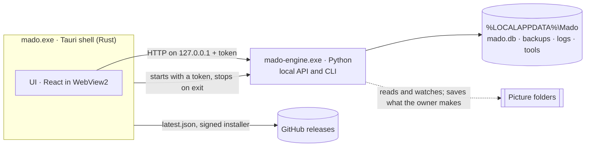
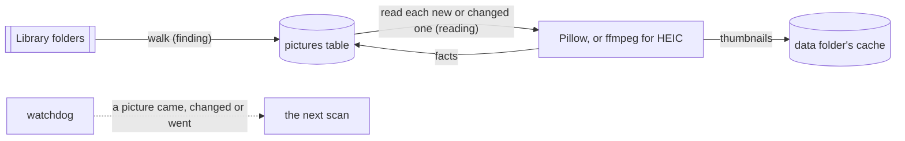
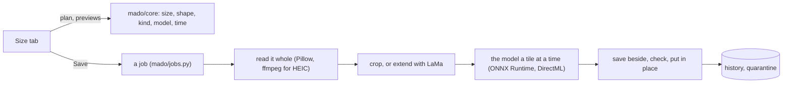

# Architecture

Mado is three programs that work as one: a thin **shell** that owns the window, a **UI** inside it,
and an **engine** that does the real work. Everything runs on this PC; the only network traffic is
fetching what the installer lists (ffmpeg, and the bigger AI models when first asked for) and
checking for updates.

| Part | Where | Does |
| --- | --- | --- |
| Shell | `app/src-tauri` | The window and its title bar, one instance at a time, the engine's lifetime, updates, the tray |
| UI | `app/src` | Every screen. Reads and changes things only through the engine's API |
| Engine | `engine/src/mado` | The library (its folders, the scan, the watcher, the copies the window shows), making pictures right for a screen (the AI models on the graphics card) and saving them, History and the quarantine, this PC's check, Setup's downloads, settings, backups, the export, the database |

The shell stays small on purpose: logic that isn't about the window or the process belongs in the
engine, where it is easy to test.

## Start, run, stop

1. The shell starts `mado serve --watch-stdin` with a fresh random token in `MADO_TOKEN`
   (in development: `uv run mado …` from `engine/`; installed: the bundled `mado-engine.exe`).
2. The engine listens on `127.0.0.1` on a free port and prints one line:
   `{"event": "ready", "port": 51234}`.
3. The shell sends the UI an `engine-status` event with the address and token.
4. The UI calls the API with `Authorization: Bearer <token>`.
5. On exit the shell closes the engine's stdin and the engine shuts down (the shell ends it after
   3 seconds if it hasn't). If Mado crashes, Windows closes the pipe anyway, so the engine never
   outlives the window. The engine puts itself in a Windows job that ends every program it starts
   (ffmpeg) when it ends, however it ends.
6. With "Start with Windows" on (Settings › General), Windows starts Mado at sign-in in the tray.
   With "Keep Mado running when you close the window" on (beside it), closing the window keeps
   Mado there, so its work and the nightly backup carry on; Quit Mado in the tray's menu ends it.
   Off, closing the window quits Mado. After the ready line the engine may print
   `{"event": "notify", "title": …, "body": …, "link": …}` lines, which the shell shows as Windows
   notifications while the window is away, and passes to the window while it's open (the `notice`
   event), where they show as a note at its foot.

If the engine is silent for a minute before its ready line, exits first, or stops on its own later,
the status becomes `failed` with the engine's last error lines, and the UI says so with "Try again"
and "Copy details". While the window is away (Mado waiting in the tray), a Windows notification
says so once, and the shell tries again by itself after 30 seconds, a minute, 5 minutes, then every
15. Both sides of this handshake are tested: `engine/tests/test_cli.py` and
`app/src-tauri/src/engine.rs`.

## The library

The owner adds folders; the engine reads every picture in them and keeps watching. Nothing in
the folders changes: the library only looks.

| Part | File | Does |
| --- | --- | --- |
| Folders | `mado/library.py` | Adding a folder (one inside a library folder is refused; one holding library folders takes them in), taking one out, and walking one to record every picture with its size, time and place |
| Reading | `mado/pictures.py` | A picture's facts (format, size as shown, when it was taken, camera, orientation, a location) from its header and EXIF, and its pixels, turned upright (see [stack/pillow.md](stack/pillow.md)) |
| The scan | `mado/scan.py` | One at a time, on its own thread: finding (walking every folder: new, changed and gone pictures), then reading what's new or changed, newest file first, making each thumbnail on the way. Everything is saved as it goes, so a scan Mado's closing stops loses nothing |
| The watcher | `mado/watch.py` | A scan as Mado starts, and one a few seconds after a picture comes, changes or goes (see [stack/watchdog.md](stack/watchdog.md)) |
| Copies | `mado/previews.py` | A thumbnail (512 px), a view the size of a screen (2560 px) and a full-size copy for a format the window can't show, made once and kept in the cache |
| Rules | `mado/core/` | What a file is by its name, how folders sit together, EXIF's values in Mado's words, a HEIF's layout: pure functions |

A picture's copies come to the window through the API like everything else, with the token: the
UI fetches each and shows it as an object URL (`usePictureImage` in `app/src/lib/engine.tsx`),
thumbnails only as they come near the view, so the grid holds many thousands.

## Making a picture right for a screen

The Size tab asks the engine for a plan as the owner chooses (a size, the shape, the point to crop
around, what the picture is, Fast or Best), shows previews of the part being looked at, and on
Save starts a job. Nothing changes until then: the job writes a new picture beside the original,
or puts it in the original's place with the original set aside in quarantine, and History says
so. docs/stack/upscaling.md has the models, the tiles and DirectML's rules; docs/stack/hardware.md
the PC check.

| Part | File | Does |
| --- | --- | --- |
| The rules | `mado/core/` (`sizes`, `framing`, `kind`, `models`, `recipe`, `tiles`, `quality`, `estimate`, `hardware`, `naming`, `outpaint`) | Pure: the sizes, the shape and its words, what a picture is, the model it suits, the plan, the tiles, the format, the time, what this PC can do, names |
| Sessions | `mado/directml.py`, `mado/ai.py` | ONNX Runtime sessions on the card (or the processor where the card can't), made once per model and tile size, kept, run under one lock; each model's file, shipped or downloaded |
| Making | `mado/upscale.py`, `mado/extend.py`, `mado/making.py`, `mado/encode.py` | The model a tile at a time, laid into the size made; the edges drawn by LaMa; reading, making and saving with what's kept of the original |
| Jobs | `mado/jobs.py` | One job at a time on its own thread, with stage, progress, the time left and Cancel (up to saving); a job cut short started again once, or finished or taken back by its History line when it was saving |
| History | `mado/history.py`, `mado/quarantine.py` | What Mado made, a week at a time, its undo and redo (a picture's changes newest first); the quarantine on each drive, the daily clear-out after 30 days (`mado/care.py`, a drive not connected waiting for it), emptying a drive by hand |
| This PC | `mado/hardware.py`, `mado/pc_check.py` | What Windows says the PC has; the check in a process of its own (`mado check-model`), timing each model; the speeds learned from each picture made |

## Contracts

| Between | How | Kept honest by |
| --- | --- | --- |
| Shell and engine | `serve` arguments, `MADO_TOKEN`, the ready line, stdin | Tests on both sides |
| Shell and UI | Commands `engine_status`, `restart_engine`, `prepare_update`, `install_update`, `screens`; event `engine-status` | Types mirrored in `app/src/lib/engine.tsx`, `updates.ts` and `screens.ts` |
| UI and engine | JSON over HTTP, camelCase | `engine/openapi.json` snapshot + test; types in `app/src/lib/engine.tsx` |

Change a contract on both sides in the same commit.

## The engine's API

| Route | For |
| --- | --- |
| `GET /health` | Is the engine up, its version, the data folder, the schema version (0 while the records are damaged) |
| `GET /settings`, `PUT /settings` | The owner's choices; so far whether Setup is done |
| `GET /tools`, `POST /tools/{id}/download` | What Mado downloads (ffmpeg), its state, and fetching it |
| `GET /backups`, `POST /backups`, `POST /backups/import`, `POST /backups/{name}/restore` | The backups, one made by hand, importing an export, restoring one as the engine starts again |
| `GET /data`, `POST /export` | What the data folder holds, by part, and the export zip |
| `GET /folders`, `POST /folders`, `DELETE /folders/{id}` | The library's folders, each with its counts and the folders inside it as a tree; adding one (which a scan then reads, and the watcher watches); taking one out (its pictures stay where they are) |
| `GET /library` | The library in numbers, for Home: pictures, folders, size, what's still to read, camera RAW, what won't open, each folder's share |
| `GET /scan` | How the latest scan went, or is going: its stage, what it found and read, time left, folders not connected, what came and went |
| `GET /pictures` | A page of pictures by the day they were taken (`folder`, `dir`, `q`, `order`, `after`, `limit`), with each day on it counted whole |
| `GET /pictures/{id}`, `GET /pictures/{id}/neighbours` | One picture in full; the pictures either side of it in the list it was opened from |
| `GET /pictures/{id}/thumbnail`, `/view`, `/full` | Its copies (WebP, or the picture itself at full size where the window shows its format), kept by the window (their addresses carry the picture's version) |
| `POST /pictures/{id}/read` | Reads one picture again now (one that wouldn't open may have been mended) |
| `GET /sizes`, `POST /screens` | The sizes a picture can be made for (the devices, the owner's screens, prints); remembering this PC's screens as the window sees them |
| `POST /pictures/{id}/plan` | How a picture would be made to a recipe: its shape and the words for it, what it is, the model, about how long here, the format, colours and size, and the downloads it waits for |
| `POST /pictures/{id}/preview` | The picture made, all of it fitted or a part at full detail, before (stretched) or after (made): WebP, with how long it took |
| `POST /pictures/{id}/saving` | The name a picture made would be saved as, whether that's taken, and about how big it comes out |
| `POST /pictures/{id}/make` | Makes it and saves it as chosen, as a job |
| `GET /jobs`, `GET /jobs/{id}`, `POST /jobs/{id}/cancel` | The jobs (a picture's, or those under way): stage, progress, time left, what they saved, why they didn't work; Cancel |
| `GET /history`, `POST /history/{id}/undo`, `POST /history/{id}/redo`, `POST /history/clear` | History a week of days at a time (`before`, `q`); taking a new picture away or putting a replaced original back, newest first; putting a picture taken away back, or replacing an original again; clearing History |
| `GET /quarantine`, `POST /quarantine/empty` | What waits in quarantine on each drive; emptying one now |
| `GET /pc`, `POST /pc/test` | This PC: its card, processor and memory, where the models run, each kind at each quality with its time, what each starts on; testing it again |
| `GET /records`, `POST /records/restore`, `POST /records/new` | Records damaged past use, and the two ways back |

## Data

- **The data folder**, `%LOCALAPPDATA%\Mado`: `mado.db` (everything Mado knows), `logs/`
  (`engine.log`, kept 30 days), `tools/` (ffmpeg, and the AI models fetched when asked), `cache/` (the pictures' thumbnails and views,
  and the last few full-size copies: anything in it can go), and `backups/` (the last 7 nights,
  each checked as it's made, and apart from them the last 7 made by hand, before a restore and
  from an export; none is ever written over). `mado/care.py` makes tonight's backup from 03:00 (or
  the first chance after). A backup chosen in Settings is restored as the engine starts again,
  before anything opens the database, once it checks out; what Mado knew till then is backed up
  first, and kept even when it doesn't check out. Development uses `engine/.dev-data`, so it never
  touches the real folder.
- **The database** is SQLite, upgraded in place by migrations (see [stack/sqlite.md](stack/sqlite.md)).
  A database written by a newer Mado is refused, not damaged. Records damaged past use (a disk
  fault, a power cut mid-write: `mado/rescue.py`) are found as the engine starts, before anything
  else opens them; the engine then answers only `/records` and `/health`, and the app's window
  shows the way back in place of every page: the newest backup that opens, restored over them, or,
  with none, new records as on Mado's first day (when the disk couldn't read them, Try again comes
  first). Either way the damaged file is set aside as it is, never deleted, and the app starts the
  engine again.
- **The quarantine**, `Mado quarantine` at the top of each drive, a folder a day: a replaced
  original, or a picture taken away, waits there 30 days (`mado/quarantine.py`), then the daily
  clear-out deletes it. Setting one aside is a rename on its own drive. Mado deletes only what's
  in a day's folder of a quarantine, whatever its records say, and the library's scan never looks
  into one.
- **Export**: one zip, readable without Mado, written to a folder the owner picks in Settings (or
  with `mado export`): the database, its settings, the library's folders (`folders.json`), every
  picture with what Mado read of it (`pictures.csv`), History (`history.csv`), and a manifest. It grows with the
  schema. Settings imports one too: the database it holds
  is restored like a backup as the engine starts again, and what Mado knew till then is backed up
  first. An export from a newer Mado waits for an update.

## Safety on a shared PC

- The engine listens only on `127.0.0.1`, on a port chosen at random.
- Every request needs the launch's token; anything else gets 401.
- Only the app's own pages may call it (CORS), and only when addressed to this PC (Host check).
  A fault inside the engine is answered in plain words inside CORS (`api.Unexpected`), so the
  window can say so, rather than that the engine didn't answer; the details go to its log.
- The window's content security policy allows the app itself, Tauri's IPC and the local engine.
- The window may call only the core APIs, its title bar buttons and Mado's own commands
  (`app/src-tauri/capabilities/default.json`).
- An update runs only if its signature matches the public key built into Mado.

## On an installed PC

| What | Where |
| --- | --- |
| Program | `%LOCALAPPDATA%\Programs\Mado` (`mado.exe`, `engine\`, `uninstall.exe`) |
| Data | `%LOCALAPPDATA%\Mado` |
| WebView2 cache | `%LOCALAPPDATA%\io.github.frankgrobbelaar.mado` |
| Uninstaller's export | `Documents\Mado export <date>.zip` |
