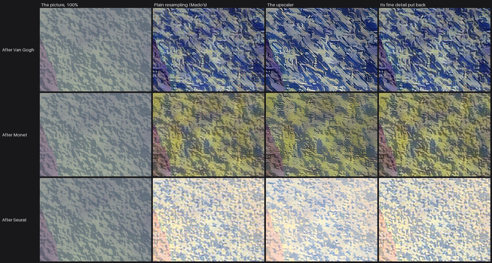

# Painting styles

The Looks tab's painting styles: four after public-domain painters, from small networks Mado
trained itself; any picture of the owner's as the style, through MicroAST; and pencil, oil paint
and cartoon drawn by code. The rules are `engine/src/mado/core/painting.py` (pure), running the
networks `engine/src/mado/painting.py`, the owner's own `engine/src/mado/own_styles.py`, the
step in a Save `engine/src/mado/making.py`, the API `engine/src/mado/api/styles.py`, and the UI
`app/src/features/picture/styles-section.tsx`.

## What's offered

| Style | Made by | Its one setting | Download |
| --- | --- | --- | --- |
| After Van Gogh | Mado's network, trained on The Starry Night | | 6.9 MB |
| After Hokusai | Mado's network, trained on The Great Wave off Kanagawa | | 6.9 MB |
| After Monet | Mado's network, trained on Water Lilies (1915) | | 6.9 MB |
| After Seurat | Mado's network, trained on The Channel of Gravelines | | 6.9 MB |
| A picture of yours, and your styles | MicroAST, from the picture's colours and textures | | 2.0 MB |
| Pencil sketch | Code: a colour dodge of the picture by its blurred negative | Darkness | |
| Coloured pencil | Code: the sketch over a pale wash of the picture's colours | Darkness | |
| Oil paint | Code: a soft Kuwahara filter, with the brush's relief | Brush | |
| Cartoon | Code: edges kept while smoothing, fewer tones, drawn edges | Colours | |

Six networks were trained (models-3); two are left out, judged in Mado on made-up pictures at
full strength, at 60% and in the pictures' own colours:

- **Klimt's Birch Forest** turns everything into the same rust-and-moss flecked tapestry: skies
  and seas become leaf litter and pictures go muddy. Neither the strength nor the picture's own
  colours rescue it: what's left is a texture, not a painting.
- **Turner's Fighting Temeraire** is a warm amber haze over a soft canvas grain, more a warm
  grade than Turner's light. The looks already do a warm grade better, and with grain.

The four kept: Van Gogh and Hokusai are the strongest and read at once as their paintings; Monet's
soft dabs are the least distinctive on their own but the gentlest on photos, and with the
picture's own colours they're the best "painted photo" of the set; Seurat's dots are pale and
high-key, pretty on daylight scenes, and keep their character in the picture's own colours. The
paintings themselves are never in Mado, the downloads or the repo.

No anime look, as CLAUDE.md rules out.

## Where it sits

A style is a step of its own, `paint`, not one of the looks: a look is a table of colours that
grades the picture, a style repaints it. Kept apart, a look can still warm or cool what's painted
(After Monet, then Golden hour), the touches go on top of both, and choosing one never clears the
other. In the recipe: the edits, the fixes, the size, then the paint step, then the look and its
touches, so grain is never painted over. The Looks tab lists the styles after the looks, as a
group of their own: a grid of small copies of the picture (None first, the painters, the classic
means, the owner's styles, a picture's style not kept yet), "A picture of yours…" last; resting
the pointer on one shows it on the picture, as the looks do.

- **Strength** mixes the painting with the picture as it was (`Image.blend`), 100% to start.
- **Keep the picture's colours** takes the painting's lightness and the picture's own colour (Y
  from the painting, Cb and Cr from the picture). Each painting imposes its palette hard (Van
  Gogh's has no red, so a red goes dark blue); with the picture's colours the brushwork stays and
  the scene reads as itself, which helps most where a palette fights the picture: Monet's olive
  skies and Seurat's washed-out nights. Offered for the networks; a classic means' colours are
  its own already.
- **On a part:** "Only on a part" is the Looks tab's, for its style as for its look: the parts
  picked go on both, and the mask composites the picture painted with the picture as it was.
- **A grey picture** is painted in the style's colours, which the tab says, unless its own colours
  are kept: then it comes back grey (one channel) when the painting left it grey.
- **See-through parts** stay as they are: what they hide is carried in from what shows before
  painting (`split_alpha`), so no dark fringe is painted in.

## The networks

Johnson et al.'s TransformerNet, as PyTorch examples' fast_neural_style writes it (BSD-3-Clause,
`LICENSE-pytorch-examples.txt` beside each download), trained by Mado on each painting for 30,000
steps on 10,000 photo-like pictures drawn by code, so the weights are Mado's own (MIT). Each takes
RGB 0 to 1 at any size whose sides are multiples of 4 and gives the painted picture back the same
way, adding a fixed faint dither first so flat skies are painted rather than streaked; the same
picture always paints the same. Each file is 6,887,451 bytes, from `models-3`, fetched the first
time its style is asked for.

- **The working size:** a style is painted whole at about 1600 × 1200, never in tiles (instance
  normalisation per tile shows seams, and its strokes would shrink with the tile), then made the
  picture's size. Mado's canvas is a 1392 × 1392 square, the same number of pixels as 1600 × 1200
  and a multiple of 4: the picture's long side becomes 1392 and the rest is mirrored out to the
  square (`np.pad`, symmetric), so one fixed size serves every shape and DirectML compiles it
  once. The dither is laid from the canvas's corner, so it doesn't move with the picture's shape.
  Strokes are the same size against the picture whatever its pixels, so the stage and the
  picture saved look alike. The small copies are thumbnails, where no stroke can show: they're
  painted on the processor on a 464 canvas (a third of the sides, a multiple of 4), so going
  through the styles never takes the card's memory for a style no one has chosen.
- **One session for the four:** the four are one graph with different weights, and a session on
  the card keeps about 2.2 GB of its memory for good (mado/directml.py never lets one go), so a
  session each wouldn't fit a 6 GB card beside the upscaler. Mado makes one session from the first
  painter's file with its 62 weights (all named `net.`) taken out of the graph as inputs
  (`core/onnx_graph.py`, its own reader and writer of the file's protocol buffers, no `onnx`
  package), and runs each painter by passing its own weights, read once from its file and checked
  against the graph's shapes. It runs as fast as each painter's own session and keeps the same
  2.2 GB. The dither tiles (`da`, `db`) are the same in all six and stay in the graph.
- **Gotcha:** making the weights inputs that *keep* their values in the graph (overridable
  initializers) gives wrong pictures on DirectML with graph fusion on: the fused node bakes in the
  first painter's weights and ignores what's passed. With the values taken out of the graph, so
  they're only inputs, every painter comes out as its own file paints it.
- **Card or processor:** a style pointed at or chosen paints on the card when this process's
  DirectX budget has room for what the session keeps (2.3 GB for the painters, 1.25 GB for
  MicroAST, plus 512 MB spare), else the processor, with `session.set_denormal_as_zero` (the same
  pictures, a little quicker); a small copy always on the processor, at its own canvas. fp16 isn't
  used: on GTX 16 cards it's slower. One lock for the card, as every model takes it, so a preview
  waits a picture's tile while the queue has the card ("Waiting for the graphics card: Phone
  wallpapers lets it go after the tile it's on").

## A picture as the style

MicroAST (Wang et al., MIT, `LICENSE-MicroAST.txt`) comes as two halves: one reads a style
picture into 512 numbers, the other paints with them. Mado reads a picture's style once, on the
processor, from a copy 512 pixels on its long side (sides multiples of 4), and keeps the numbers
(2 KB) in the recipe as base64; the painting half runs at the same 1392 canvas as the painters,
whole, never in tiles (its AdaIN uses the whole picture's statistics), with its own strength at
100%: Mado mixes afterwards, as it does for the painters. A picture smaller than 96 pixels on its
short side, or nearly one colour with nearly no texture, can't give a style and says so.

"Keep as a style" keeps it among the owner's styles: its numbers and a small copy of the picture
(160 pixels at most, WebP) to know it by, never the picture itself (migration 12, the `styles`
table; in backups, and in the export as `styles.json` with the numbers and `styles/<name>.webp`).
Names are unique and never Mado's; a kept style's number is never given to another, so a recipe
naming one deleted fails rather than painting with another. A style a recipe uses, or pictures
in the queue are painted with, can't be deleted.

## Pencil, oil paint and cartoon

NumPy and Pillow only (no OpenCV), each worked out at a scale where its reach is a few pixels and
then made the picture's size, so they're quick at any size. Every reach is a hundredth of the
picture made's short side, so a preview and the picture saved look alike.

- **Pencil sketch:** the picture's grey divided by its blurred negative (a colour dodge), so only
  where it changes leaves a line, darker as its darkness goes up. **Coloured pencil:** each colour
  laid lightly on the paper under the lines (a pale wash of the picture times the sketch).
- **Oil paint:** a soft Kuwahara filter (each pixel the mean of four quadrants weighted by one
  over their variance to the fourth), worked out where its squares are 6 pixels, then made the
  picture's size, with a brush-stroke relief lit from the top left; the setting is the brush.
- **Cartoon:** after Winnemöller: Kuwahara smoothing, the lightness in soft steps (a tanh between
  them), colour kept and lifted a little, then edges drawn from a difference of Gaussians; the
  setting is how many tones.

## Enlarging

A style is painted at the working size and made the picture's size, or the Size tab's. Three ways
were tried on made-up pictures made 12 MP (4032 × 3024), each looked at in 100% crops:

- **Plain resampling** (Lanczos), Mado's: keeps the painted texture as it was painted, a little
  soft seen close, in 0.14 s for 12 MP.
- **The upscaler** (Real-ESRGAN general, then down to size) cleans as it grows: it draws hard
  white streaks into Van Gogh's dabs, cracks into Monet's, smears Seurat's dots into blotches, and
  takes about 23 s on the processor.
- **The picture's fine detail put back** (its detail finer than the working size added to the
  painting's lightness) looks nearly the same as plain resampling, and where it shows it prints
  the photo through the paint, for 1.0 s more at 12 MP.

A picture made more than five times bigger than it was painted (8K and up from the working size)
says so where it's chosen: "Painted at 1392 × 783, then made 7680 × 4320: about 6 times bigger,
so seen close its strokes are soft. A smaller size on the Size tab keeps them crisp."

## Measured on the owner's PC

GTX 1660 Super 6 GB, i5-9600K, onnxruntime-directml 1.24.4, 2026-11-24, through Mado's own code
(`Painter.paint`, `making.paint`, `core.painting.classic`), each part in a process of its own with
the card quiet, on made-up pictures drawn by code.

A style at the working size (a 1600 × 1200 picture on the 1392 canvas: made smaller, painted,
cut back), the session made; the first is its first run, which makes the session:

| Style | Card | Card, first | Processor |
| --- | --- | --- | --- |
| After Van Gogh | 0.34 s | 1.13 s | 2.60 s |
| After Hokusai | 0.34 s | 0.34 s (the session is shared) | 2.45 s |
| After Monet | 0.34 s | 0.35 s | 2.52 s |
| After Seurat | 0.34 s | 0.35 s | 2.73 s |
| A picture's style (MicroAST) | 0.22 s | 0.84 s | 1.55 s |

The whole painting step of a Save (painted at the working size, made the picture's size, mixed),
and writing the result as JPEG at 92:

| | Card | Processor |
| --- | --- | --- |
| 12 MP (4000 × 3000), After Monet | 0.63 s | 2.86 s |
| 12 MP, at 70% in its own colours | 0.81 s | 3.04 s |
| 8K (7680 × 4320), After Monet | 1.10 s | 3.27 s |
| 8K, at 70% in its own colours | 1.59 s | 4.46 s |
| 12 MP, a picture's style | 0.52 s | 1.97 s |
| Writing it, 12 MP; 8K | 0.06 s; 0.11 s | |

Reading a picture's style (MicroAST's first half, on the processor, from a 1200 × 900 picture):
44 ms (0.17 s the first time). Making a painting the size of a 12 MP picture alone: 0.14 s. A
small copy, from a thumbnail 256 pixels across, on the processor at the 464 canvas: 0.38 to
0.41 s a painter (0.75 s the first, which makes the session), 0.23 s a picture's style.

The card's memory each keeps for the engine's life: the painters' one session 2.2 GB (2,206 MiB),
MicroAST's painting half 1.2 GB (1,184 MiB); the style reader runs on the processor.

The classic means on the processor, at their first setting (a small copy is 256 × 192, the stage's
preview 1536 × 1152):

| | A small copy | The preview | 12 MP | The preview, setting at 0; at 100 |
| --- | --- | --- | --- | --- |
| Pencil sketch | 2 ms | 73 ms | 0.50 s | 62 ms; 79 ms |
| Coloured pencil | 5 ms | 0.21 s | 1.36 s | 0.20 s; 0.20 s |
| Oil paint | 15 ms | 0.29 s | 0.38 s | 0.84 s; 0.11 s |
| Cartoon | 14 ms | 0.40 s | 0.52 s | 0.41 s; 0.41 s |

The trainer timed each network alone at 1600 × 1200: 0.25 s on the card and 3.7 s on the
processor. Mado's runs on the processor came out quicker, about 2.5 s, through the same graph.
